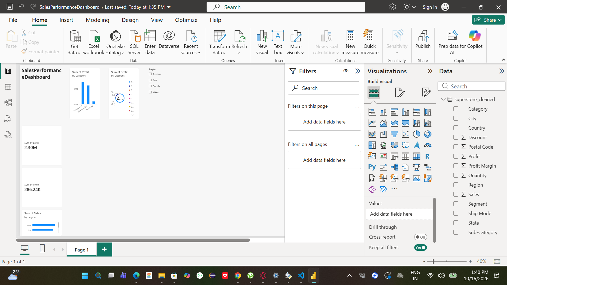

# Sales Performance & Revenue Optimization Dashboard

## Project Overview
An end-to-end data analysis project analyzing 9,977 retail transactions to uncover revenue trends, regional performance, and discount impact.

## Tech Stack
- **Python (Pandas):** Data cleaning and feature engineering.
- **SQL (SQLite):** Business analysis queries (aggregations, CTEs, CASE statements).
- **Power BI:** Interactive dashboard development with slicers.

## Key Business Insights
1. **Discounts Destroy Profit:** Orders with a 0% discount generate 76.1% of total profit. Orders with discounts above 20% result in a net loss.
2. **Furniture is a Loss Leader:** The Furniture category generates significant revenue but has the lowest profit margin, with Tables and Bookcases often selling at a loss.
3. **West Region Dominates:** The West region generates the highest total sales.

## Dashboard Preview

## Business Recommendations
1. **Cap Discounts at 15%:** Implement a strict policy to prevent discounts above 15%, as they consistently lead to negative profit margins.
2. **Review Furniture Pricing:** Re-evaluate the pricing strategy for Tables and Bookcases to improve profitability.
3. **Focus on Technology:** Increase marketing efforts for Technology products, which have the highest profit margins.